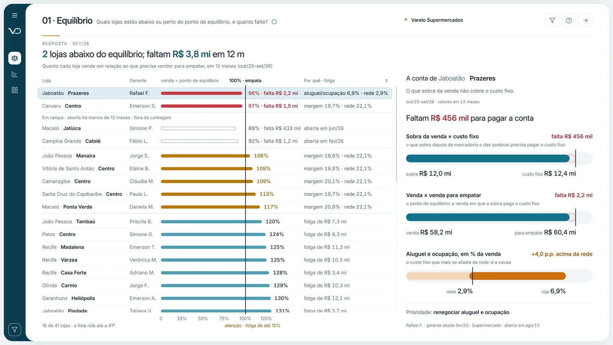

# Análise Comercial

**Quais lojas estão abaixo ou perto do ponto de equilíbrio?**

Painel Power BI de demonstração da Vizu Dados, com dados fictícios.

*Varejo · lojas, mix e fornecedores*

## O que ele mostra
- Ponto de equilíbrio
- Margem
- Curva ABC
- Matriz BCG

## Ver o painel
- [Abrir o painel interativo](https://app.powerbi.com/view?r=eyJrIjoiYzUxYzMyM2MtNDE4NS00MTIyLTgyMmUtNjY2NjZhOTQxMDc2IiwidCI6IjQ3ZWU2OTdmLWVkNDctNDY2Ni1hNzk2LTJjMTBhNzI2MDMzNCJ9&pageName=T1)
- [Todos os painéis em vizudados.com.br](https://vizudados.com.br/power-bi#analise-comercial)

© Vizu Dados
